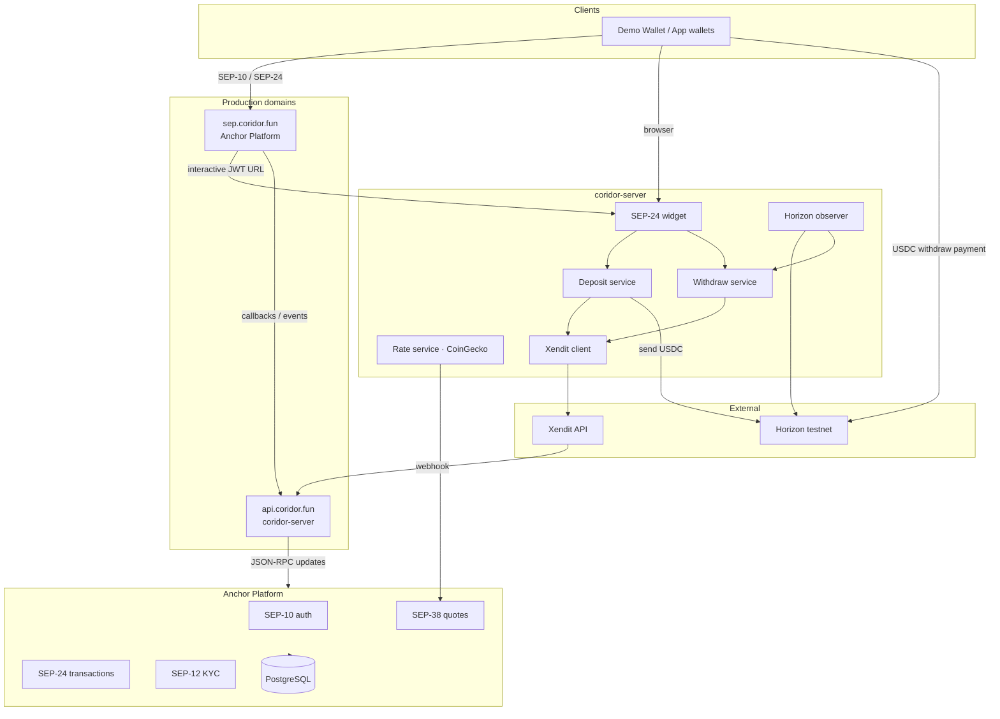

# Architecture

Coridor runs on **Stellar Anchor Platform** plus a custom **coridor-server** for Xendit, rates, and the SEP-24 widget.

---

## System diagram



---

## Components

| Component | Host | Role |
|-----------|------|------|
| **Anchor Platform** | `sep.coridor.fun` | SEP-10, SEP-12, SEP-24, SEP-38; `stellar.toml`; transaction state |
| **coridor-server** | `api.coridor.fun` | Widget UI, Xendit, dynamic rates, platform callbacks, on-chain observer |
| **PostgreSQL** | Internal | Anchor transaction and KYC data |
| **Kafka** | Internal | Platform events (callbacks) |
| **Xendit** | External | IDR pay-in (VA, QRIS, OVO) and bank payout |
| **Horizon** | External | Classic USDC payments (withdraw detection, deposit send) |

---

## Request paths

### Deposit

```
Wallet → SEP-10 → SEP-24 deposit → api.coridor.fun/sep24/interactive
  → User pays IDR (Xendit) → webhook → coridor-server → Platform
  → Distribution account sends USDC → User wallet
```

### Withdraw

```
Wallet → SEP-10 → SEP-24 withdraw → widget (bank details)
  → pending_user_transfer_start → User sends USDC + memo
  → Observer → Xendit payout → User bank
```

---

## Standards (SEPs)

| SEP | Purpose |
|-----|---------|
| SEP-1 | `stellar.toml` at `sep.coridor.fun` |
| SEP-10 | Wallet authentication |
| SEP-12 | KYC (auto-accept on staging) |
| SEP-24 | Interactive deposit / withdraw |
| SEP-38 | Indicative and firm USDC/IDR rates |

SEP-45 is disabled; classic USDC uses Horizon observer.

---

## Key accounts (testnet)

| Account | Purpose |
|---------|---------|
| `GCACTDNRY4V7QD4M6FSPGLCR5BNANSLBHIKACRTPSZ4B75NKL66QGSVS` | Distribution — USDC inventory |
| USDC issuer `GATALTGTWIOT6BUDBCZM3Q4OQ4BO2COLOAZ7IYSKPLC2PMSOPPGF5V56` | Asset users trustline and receive |

---

## Deployment note

VPS deploy, env vars, and Docker setup live in the backend repo: [DEPLOY.md](../DEPLOY.md) (not duplicated here).

---

## Related

- [How Coridor works](./how-coridor-works.md)
- [stellar.toml & SEP](./developers/stellar.md)
- [HTTP API](./developers/api.md)
