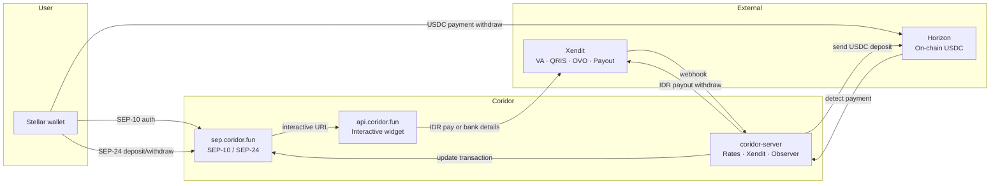

# How Coridor works

Coridor follows the standard **Stellar anchor** pattern: authenticate, start a SEP-24 transaction, complete fiat steps in an interactive widget, then settle USDC on-chain.

---

## High-level flow

---

## Deposit (on-ramp): IDR → USDC

1. User authenticates with **SEP-10** against `sep.coridor.fun`
2. Wallet starts **SEP-24 deposit** → receives interactive URL + transaction id
3. User opens widget, enters IDR amount, picks **VA**, **QRIS**, or **OVO**
4. User pays (or **Simulate** in sandbox)
5. Xendit webhook confirms payment → coridor-server notifies Anchor Platform
6. Anchor sends **USDC to the user's Stellar account**

The wallet does **not** send USDC for deposit — Coridor delivers it after IDR is confirmed.

---

## Withdraw (off-ramp): USDC → IDR

1. **SEP-10** → **SEP-24 withdraw** → interactive widget
2. User enters **bank account** details (bank name, account number, holder name)
3. Status becomes **`pending_user_transfer_start`**
4. Wallet sends **USDC** to Coridor's distribution account with the required **memo**
5. On-chain observer detects payment → coridor-server triggers **Xendit bank payout**
6. IDR arrives in the user's bank account; SEP-24 status → **`completed`**

---

## Rates and fees

- Market **USDC/IDR** from CoinGecko
- Default: **Rp 5,000** flat + **~0.5%** spread
- Exposed via **SEP-38** and public `GET /rate` on `api.coridor.fun`

Use **Rp 50,000+** for deposits so the flat fee does not dominate small amounts.

---

## What happens in the widget

| Flow | User does in widget |
|------|---------------------|
| Deposit | Amount IDR + payment method + pay / simulate |
| Withdraw | Bank details + confirm |

KYC (SEP-12) is simplified on staging (auto-accept). Production follows anchor policy.

---

## For developers

Integration is step-by-step in the [Developers](./developers/index.md) section:

1. [Authenticate (SEP-10)](./developers/authenticate.md)
2. [Initiate transaction (SEP-24)](./developers/initiate-transaction.md)
3. [Poll status](./developers/poll-status.md)
4. [Send/receive USDC on-chain](./developers/send-receive-funds.md) (withdraw)

---

## Related

- [What is Coridor?](./what-is-coridor.md)
- [Architecture](./architecture.md)
- [Deposit guide](./deposit.md) · [Withdraw guide](./withdraw.md)
